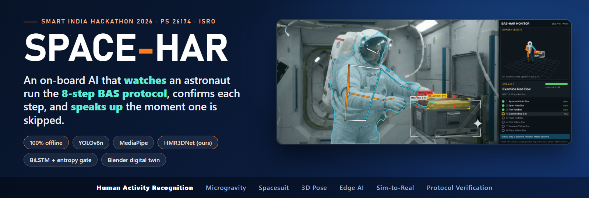
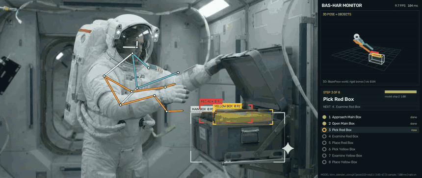
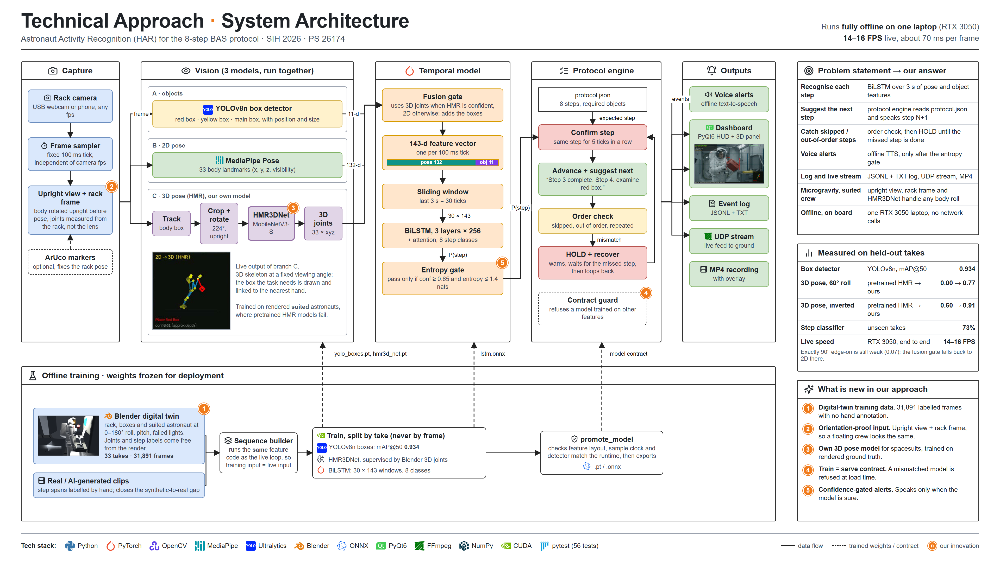
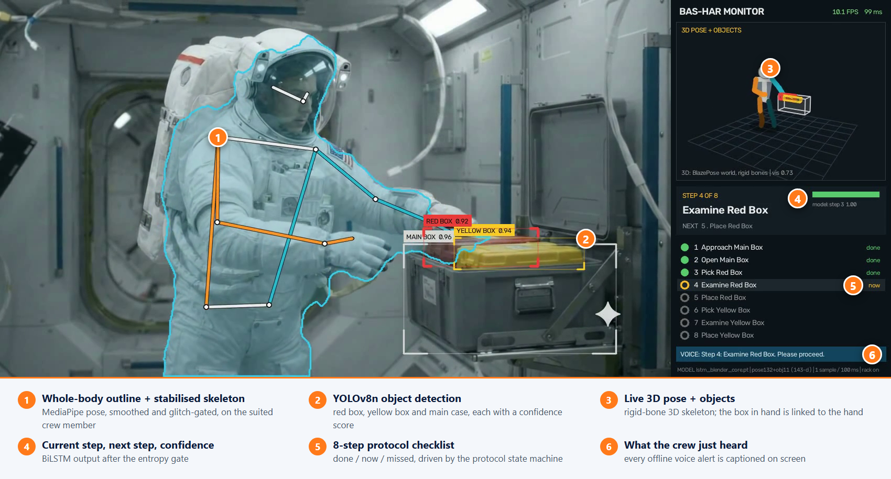
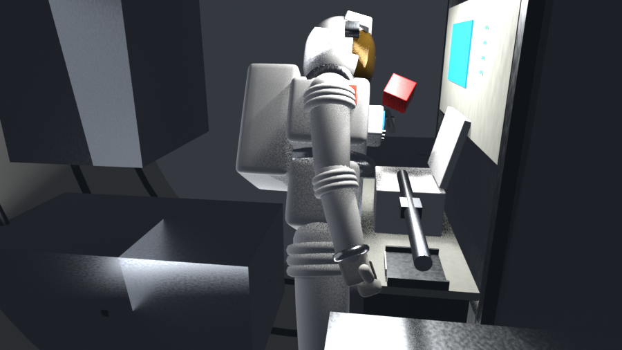
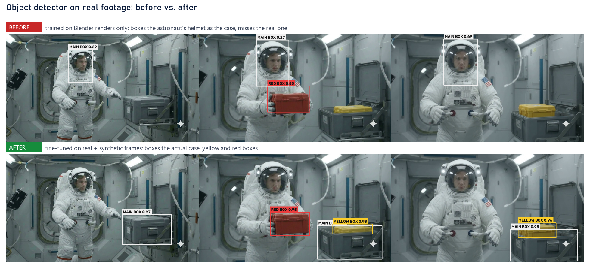
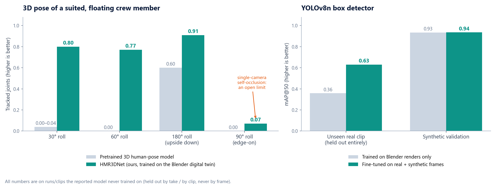

<p align="center">
  
</p>

<p align="center">
  
  
  
  
  <br>
  
  
  
  
  
  
  
</p>

# Space-HAR: Astronaut Activity Recognition for the BAS Protocol

> **Team Traviators** · Smart India Hackathon 2026 · ISRO

| Field | Detail |
|---|---|
| **Problem Statement ID** | 26174 |
| **Problem Statement Title** | AI Human Activity Recognition for On-board BAS Experiments |
| **Organization** | Indian Space Research Organisation (ISRO) |
| **Theme** | Space Technology |
| **Category** | Software |
| **Team Name** | Traviators |

## TL;DR

- **Problem.** An astronaut runs an 8-step experiment on the Bharatiya Antariksh Station (BAS). A skipped or out-of-order step can spoil it, nobody on the ground is watching the video feed, and crew time is precious.
- **Solution.** One fixed camera plus an AI pipeline that **recognises each step, confirms it, announces the next one, and speaks up the moment a step is skipped**. It runs fully **offline on a single laptop GPU**.
- **Why it is different.** Off-the-shelf pose models fail on a suited, floating body (they track **0%** of it at 60° of roll). We built a Blender **digital twin** to generate exact training data and trained our own 3D pose model, **HMR3DNet**, which tracks **77%**.

<p align="center">
  
  <br><sub>Live monitor on an AI-generated astronaut video. The checklist advances from step 3 to step 4 and the voice alert is captioned. This clip is part of the training mix; held-out numbers are in <a href="#results-measured-never-on-training-data">Results</a>.</sub>
</p>

## Contents

[The problem](#the-problem) · [Our solution](#our-solution) · [Why this scores](#why-this-scores) · [What you see on screen](#what-you-see-on-screen) · [Three models, three jobs](#three-models-three-jobs) · [Digital twin](#digital-twin-our-training-data-factory) · [Results](#results-measured-never-on-training-data) · [Quick start](#quick-start) · [Reproduce the training](#reproduce-the-training) · [Repository structure](#repository-structure) · [Requirement coverage](#problem-statement-requirement-coverage) · [Limitations and roadmap](#known-limitations-and-roadmap) · [Docs](#documentation) · [Team](#team)

---

## The problem

Astronauts follow scripted protocols on payload racks. The reference protocol in this project is an **8-step red and yellow box sort**:

`1 Approach Main Box` → `2 Open Main Box` → `3 Pick Red Box` → `4 Examine Red Box` → `5 Place Red Box` → `6 Pick Yellow Box` → `7 Examine Yellow Box` → `8 Place Yellow Box`

The problem statement asks for a trained model on a **standalone, offline system** that watches a fixed payload camera, validates the sequence, suggests the next step, **alerts by voice** on a skipped or out-of-sequence step, keeps a **timestamped log**, **streams to an IP and stores locally**, and shows everything in a **GUI**. Raw video is not meant to be streamed to the ground, so the verification has to happen on board.

This is hard for a reason that is easy to miss: the crew member is **floating** (any orientation, no "up"), **wearing a bulky suit**, and standard human-pose models were trained on people standing in normal clothes on Earth.

## Our solution

<p align="center">
  
</p>

1. **Capture.** A fixed camera feeds frames on a **100 ms clock** that is independent of the camera's frame rate. The frame is rotated upright and joints are measured **relative to the payload rack**, not the camera, so any crew orientation looks the same to the model.
2. **Vision (three models run together).** **YOLOv8n** finds the red box, yellow box and main case. **MediaPipe BlazePose** gives a 33-landmark skeleton. **HMR3DNet (ours)** gives 3D pose for a suited, floating body.
3. **Fusion.** Pose and object data become one **143-dimensional feature vector** per tick (132 pose + 11 object). The last **3 seconds = 30 vectors** form a sliding window.
4. **Temporal model.** A **BiLSTM (3 layers × 256) with attention** outputs a probability over the 8 steps. An **entropy gate** (confidence ≥ 0.65 and entropy ≤ 1.4 nats) means the system stays quiet when it is unsure.
5. **Protocol engine.** A state machine **confirms** a step after 5 consecutive agreeing samples, **announces the next step**, and on a skip or out-of-order action **holds, warns by voice, and waits for recovery**.
6. **Outputs.** Offline voice alerts, a monitoring dashboard with a live 3D view, a timestamped **JSONL + TXT** log, a **UDP stream** and a local **MP4** recording.

## Why this scores

| SIH criterion | What we built | Evidence in this repo |
|---|---|---|
| **Innovation and novelty** | Our own 3D pose model for suited, floating crew, trained on a Blender digital twin. Orientation-agnostic features (rack frame). A model-contract guard that refuses a mismatched checkpoint. An entropy-gated decision engine. | [`results.png`](sih-har-isro/docs/readme/results.png), [`train/hmr3d_model.py`](sih-har-isro/train/hmr3d_model.py), [`pipeline/rack_frame.py`](sih-har-isro/pipeline/rack_frame.py) |
| **Technical depth** | Three vision models, a temporal classifier and a state machine, with one shared feature code path for training and live inference. Every number is held out **by take, never by frame**. | [`pipeline/features.py`](sih-har-isro/pipeline/features.py), [`tools/promote_model.py`](sih-har-isro/tools/promote_model.py), [`tests/`](sih-har-isro/tests) (56 tests) |
| **Feasibility and practicability** | Runs **offline** on one RTX 3050 laptop at roughly **10 to 18 FPS**. ONNX export for the classifier. Works with a phone camera (DroidCam) as well as a USB webcam. No cloud call anywhere. | [`pipeline/har_pipeline.py`](sih-har-isro/pipeline/har_pipeline.py), [Quick start](#quick-start) |
| **User experience** | A monitor that shows what the system perceives and decides: skeleton, boxes, 3D view, checklist, and a caption of every voice alert. | [What you see on screen](#what-you-see-on-screen) |
| **Scalability** | The protocol (steps and required objects) lives in one config file. A new rack or protocol means a new scene in the digital twin, regenerated labelled data and a retrain. | [`config/experiment_config.py`](sih-har-isro/config/experiment_config.py), [`blender/`](sih-har-isro/blender) |
| **Honesty and rigour** | Failure cases are measured and published, including the one we have not solved. | [Results](#results-measured-never-on-training-data), [Limitations](#known-limitations-and-roadmap) |

## What you see on screen

<p align="center">
  
</p>

## Three models, three jobs

| Model | Job | Why this one, and not an alternative |
|---|---|---|
| **YOLOv8n** (fine-tuned) | Where are the red box, yellow box and main case? | A cloud vision API is **ruled out** by the offline requirement. We also tried open-vocabulary detectors: **YOLO-World** returned nothing on 3 of 4 test frames, and **Grounding DINO** is accurate but far too heavy for the live loop, so we use it **only offline as a labelling teacher** ([`tools/pseudo_label_boxes.py`](sih-har-isro/tools/pseudo_label_boxes.py)). A nano model trained on exactly three objects is small, fast and accurate enough. |
| **MediaPipe BlazePose** | 33-landmark skeleton, metric 3D world landmarks, body mask. | It is built for on-device real-time use and ships as a file on disk, so it needs no network. General human pose is a solved problem, so we spend our scarce labelled data on the unsolved part (below) instead. We add **upright canonicalisation**, because MediaPipe stops detecting a body that is not upright. |
| **HMR3DNet** (ours) | 3D pose of a **suited, floating** body at any roll. | Pretrained 3D human-mesh models track **0%** of the body at 60° roll, because they were trained on upright people in everyday clothes, and no public dataset of suited astronauts exists. So we generated one (next section) and trained a MobileNetV3-Small regressor on it. |

On top of these sit the **BiLSTM temporal model** (what step is this 3-second clip?) and the **protocol engine** (is that the step we expected?). The classifier's job is hard on purpose: it has to work from pose and object positions alone, because those are the only things that survive a change from rendered to real footage.

## Digital twin: our training data factory

<p align="center">
  
</p>

No dataset of astronauts doing this protocol exists, so the training data is **generated**. A Blender scene of the payload rack, boxes and a suited crew member is rendered at **every roll, pitch and lighting condition, including a failed light**, with **exact 3D ground truth** coming from the render itself: **33 takes, 31,891 frames, no hand annotation**. We then add real and AI-generated clips (labelled automatically, see below) to close the **sim-to-real gap**. Details: [`docs/BLENDER_DIGITAL_TWIN.md`](sih-har-isro/docs/BLENDER_DIGITAL_TWIN.md) and [`blender/README.md`](sih-har-isro/blender/README.md).

**Closing the sim-to-real gap on the detector.** Trained on renders alone, YOLOv8n boxes the astronaut's helmet as "the case" on real video. We label real frames automatically with Grounding DINO plus pixel checks (hue must fill the box, the case must be the body and not the lid) and fine-tune:

<p align="center">
  
  <br><sub>These frames come from a clip the fine-tune used, so they show the failure being fixed, not generalisation. The held-out score is in <a href="#results-measured-never-on-training-data">Results</a>.</sub>
</p>

## Results (measured, never on training data)

<p align="center">
  
</p>

Every number below comes from runs or clips the reported model **never trained on**, held out by whole take or whole clip, **never by frame** (neighbouring frames are near-duplicates, so a frame split would leak and inflate every score).

| Component | Metric | Before | After |
|---|---|---:|---:|
| **YOLOv8n box detector**, unseen real clip | mAP@50 | 0.36 | **0.63** |
| YOLOv8n, synthetic validation (no regression) | mAP@50 | 0.93 | 0.94 |
| **HMR3DNet**, 60° roll | tracked joints (vs pretrained) | 0.00 | **0.77** |
| HMR3DNet, upside down (180°) | tracked joints | 0.60 | **0.91** |
| HMR3DNet, exactly 90° roll | tracked joints | 0.00 | 0.07 (open limit) |
| **BiLSTM step classifier**, takes unseen by both models | step accuracy (chance is 0.125) | 0.68 | **0.71** |
| Live pipeline | end-to-end FPS, RTX 3050 laptop | n/a | 10–18 (about 8 with the HMR3DNet panel) |

"Tracked joints" is the median upper-body joint error under 0.5× torso length against Blender's exact ground truth. The detector's "after" number is the deployed recipe run with one whole clip held out (an earlier recipe reached 0.80 on the same clip). The deployed detector is then trained on every clip, so its score on those clips is not a held-out figure. The step classifier is the weakest link at about 0.7 on unseen takes, and we say so.

## Quick start

```bash
git clone https://github.com/vedant91/Space-HAR.git && cd Space-HAR
git lfs install && git lfs pull        # model weights, .npy and .mp4 files are stored in Git LFS

python -m venv .venv && .venv\Scripts\activate     # Linux/macOS: source .venv/bin/activate
pip install -r sih-har-isro/requirements.txt       # for GPU, install the CUDA build of PyTorch first

cd sih-har-isro
python main.py --mode status                       # verifies weights, pose backend and detector all load
```

| Goal | Command |
|---|---|
| Run live on a camera (USB or DroidCam) with the 3D view driven by HMR3DNet | `python main.py --mode pipeline --camera 0 --viz-3d hmr` |
| Run on a video file, no GUI | `python main.py --mode pipeline --video clip.mp4 --headless` |
| Render the full monitor view for a video to an MP4 | `python tools/render_har_video.py --video clip.mp4 --out monitor.mp4 --viz-3d hmr` |
| Also push the annotated feed to a ground station over UDP | `python main.py --mode pipeline --stream --stream-host <ip> --stream-port 5000` |
| Check camera framing before a demo | `python tools/camera_align.py --camera 1` |
| Run the test suite | `pytest` |

Pose bundles ship via Git LFS so a fresh clone is offline-capable; `python tools/fetch_pose_model.py` re-fetches them if needed.

## Reproduce the training

```bash
cd sih-har-isro
# 1. Digital-twin data (Blender): see blender/README.md  (renders 33 takes with exact ground truth)
# 2. Step classifier, honestly scored on held-out takes
bash tools/retrain_and_evaluate.sh dataset/blender_core
# 3. 3D pose model, supervised by Blender's 3D ground truth
python tools/prepare_hmr3d_dataset.py && python train/train_hmr3d.py
# 4. Box detector: label real clips automatically, then fine-tune (hold one clip out to measure)
python tools/pseudo_label_boxes.py --video clipA.mp4 clipB.mp4 --out dataset/yolo_boxes_real/labelled
python train/train_yolo_boxes.py --real dataset/yolo_boxes_real/labelled --holdout clipB
# 5. Serve a checkpoint: checks its recorded feature layout, clock and detector against the runtime
python tools/promote_model.py models/<checkpoint>.pt
```

## Repository structure

```
Space-HAR/
├── README.md
└── sih-har-isro/
    ├── main.py                       entry point: pipeline / train / status / ...
    ├── config/experiment_config.py   protocol steps, thresholds, 100 ms clock, feature layout
    ├── pipeline/                     the live system
    │   ├── har_pipeline.py             capture → perceive → fuse → classify → decide → render
    │   ├── yolo_detector.py            YOLOv8n red / yellow / main-box detector
    │   ├── pose_backend.py             MediaPipe Tasks pose (+ 3D world landmarks, body mask)
    │   ├── upright_pose.py             rotate the frame upright before pose (crew at any roll)
    │   ├── rack_frame.py               joints relative to the payload rack, not the camera
    │   ├── hmr_backend.py              HMR3DNet inference: track, crop, rotate, 3D joints
    │   ├── features.py                 ONE feature code path shared by training and live
    │   ├── state_machine.py            confirm / advance / skip-check / HOLD and recover
    │   ├── voice_alert.py              offline text-to-speech
    │   ├── logger.py                   timestamped JSONL + TXT log
    │   ├── stream_sender.py            ffmpeg → UDP
    │   └── pose_viz.py                 monitor: stabilised skeleton, rigid 3D view, side panel
    ├── train/                        train_lstm.py · train_hmr3d.py · hmr3d_model.py · train_yolo_boxes.py
    ├── tools/                        build_sequences · promote_model · evaluate_real · pseudo_label_boxes · render_har_video
    ├── blender/                      digital-twin scene and dataset generator
    ├── gui/qt_dashboard.py           PyQt6 monitoring GUI
    ├── models/                       trained weights (Git LFS)
    ├── tests/                        56 pytest checks: contract guard, features, state machine, ...
    └── docs/                         architecture, research references, design notes
```

## Problem statement requirement coverage

| Requirement | Where |
|---|---|
| Train an AI model that recognises and validates a pre-defined experiment sequence | [`train/train_lstm.py`](sih-har-isro/train/train_lstm.py), [`train/train_hmr3d.py`](sih-har-isro/train/train_hmr3d.py), [`train/train_yolo_boxes.py`](sih-har-isro/train/train_yolo_boxes.py) |
| Standalone edge system, local processing, fixed payload camera, no raw-video streaming to ground | [`pipeline/har_pipeline.py`](sih-har-isro/pipeline/har_pipeline.py): inference is fully offline; streaming is optional and off by default |
| Dataset generation for object detection, pose estimation and hand-object interaction | [`blender/`](sih-har-isro/blender) digital twin, [`tools/build_sequences.py`](sih-har-isro/tools/build_sequences.py), [`tools/pseudo_label_boxes.py`](sih-har-isro/tools/pseudo_label_boxes.py) |
| Continuously process video and **suggest the next step** at the start and after each step | [`pipeline/state_machine.py`](sih-har-isro/pipeline/state_machine.py), `voice_alert.alert_step_next` |
| **Voice alert** on a skipped or out-of-sequence step | [`pipeline/voice_alert.py`](sih-har-isro/pipeline/voice_alert.py) with the state machine's recovery path |
| **Timestamped, structured, lightweight log** of steps and outcomes | [`pipeline/logger.py`](sih-har-isro/pipeline/logger.py) (JSONL + TXT) |
| **Stream to a specific IP and store locally** | [`pipeline/stream_sender.py`](sih-har-isro/pipeline/stream_sender.py) (UDP) plus a local MP4 recorder |
| **GUI** for monitoring | [`gui/qt_dashboard.py`](sih-har-isro/gui/qt_dashboard.py), [`pipeline/pose_viz.py`](sih-har-isro/pipeline/pose_viz.py) |
| Deliverable: a trained model on an offline standalone system | [`models/`](sih-har-isro/models), served through the contract check in [`tools/promote_model.py`](sih-har-isro/tools/promote_model.py) |
| *Optional:* orientation-agnostic 3D tracking relative to the rack, not the floor | [`pipeline/rack_frame.py`](sih-har-isro/pipeline/rack_frame.py), [`pipeline/upright_pose.py`](sih-har-isro/pipeline/upright_pose.py), [`pipeline/hmr_backend.py`](sih-har-isro/pipeline/hmr_backend.py) |

## Known limitations and roadmap

We state these plainly, because every number above is reported the same way.

| Limitation | Why | Next step |
|---|---|---|
| Exactly **90° roll** is still weak (0.07) | Half the body is hidden from a single fixed camera. This is an information limit, not a training-data gap. | A second camera angle |
| A camera mounted **directly overhead** degrades the 2D skeleton | MediaPipe is trained on front and side views. Detection and step classification are largely unaffected. | Fine-tune pose on overhead renders from the digital twin |
| A clip that **starts mid-protocol** reports step 1 as skipped, repeatedly | Correct by the protocol rules, but the warning is not yet throttled | Warn once per missed step, plus a `--start-step auto` option |
| Step classifier is about **0.7** on unseen takes | The binding constraint is the number of distinct training takes | More takes, and more real-footage labels |
| Not yet on flight-class hardware | Developed and measured on an RTX 3050 laptop | Port the ONNX models to an embedded GPU |

## Documentation

| Document | What it covers |
|---|---|
| [`docs/sih-architecture/slide1.png`](sih-har-isro/docs/sih-architecture/slide1.png) | Full system architecture diagram |
| [`docs/sih-architecture/research.png`](sih-har-isro/docs/sih-architecture/research.png) | Literature grounding: 20 sources and where prior work stops |
| [`docs/problem-statement-explained.pdf`](sih-har-isro/docs/problem-statement-explained.pdf) | The problem statement in plain English |
| [`EXPLANATION.md`](sih-har-isro/EXPLANATION.md) · [`PROJECT_CONTEXT.md`](sih-har-isro/PROJECT_CONTEXT.md) | End-to-end walkthrough and project state |
| [`docs/BLENDER_DIGITAL_TWIN.md`](sih-har-isro/docs/BLENDER_DIGITAL_TWIN.md) | How the digital twin and its ground truth are generated |
| [`docs/designs/step-classifier-generalisation.md`](sih-har-isro/docs/designs/step-classifier-generalisation.md) | Why the step classifier generalises (or not), and the plan |
| [`logs/RESULTS.md`](sih-har-isro/logs/RESULTS.md) | Evaluation logs and reproduction steps |

## Team

**Team Traviators**, Smart India Hackathon 2026.

<!-- TODO(team): add member names and roles, the demo video link and the presentation link here. -->

---

<sub>**Keywords:** Human Activity Recognition (HAR) · ISRO · Bharatiya Antariksh Station (BAS) · microgravity · spacesuit · astronaut monitoring · protocol verification · 3D human pose · Human Mesh Recovery (HMR) · YOLOv8 · MediaPipe BlazePose · BiLSTM · attention · entropy gating · edge AI · offline inference · digital twin · synthetic data · sim-to-real · pseudo-labelling · Grounding DINO · Blender · ONNX · PyTorch · PyQt6 · SIH 2026 · PS 26174</sub>
